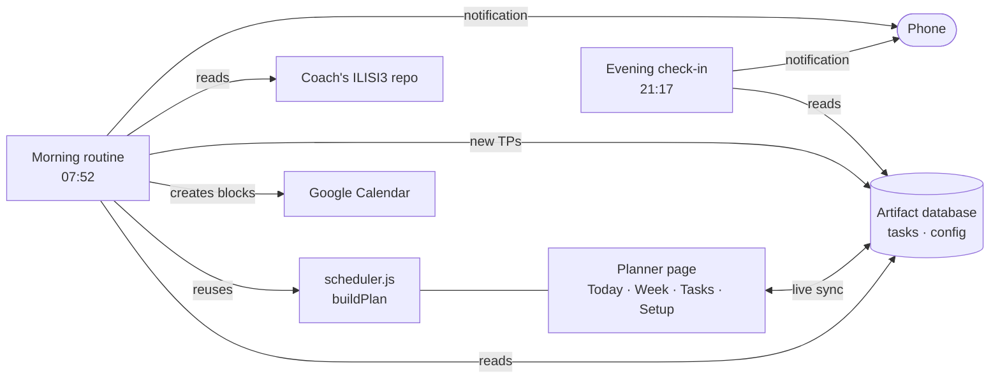

# The Planner

**Focus Board** is my personal planner for a busy semester: ILISI3 courses, labs, interview practice and portfolio projects. I enter each task with an estimate and a deadline, set how many hours I have each day, and it builds the plan for me. Every morning the day's work lands on my Google Calendar and I get a notification; every evening I get a check-in.

[](https://github.com/abdellahBSK/ThePlanner/actions/workflows/ci.yml)

## Features

- **Automatic scheduling.** Each day's hours are filled earliest deadline first, after daily habits such as interview practice, with a cap on how long one task can take in a day.
- **Variable hours.** Each weekday has default hours, and any single day can be changed with − / +. The plan reflows instantly.
- **Deadline risk.** Tasks that won't be finished in time are flagged, with the date they would actually finish.
- **Progress logging.** Log 30 minutes, mark a block done for today, or finish a task. Unfinished work rolls over by itself.
- **Estimated vs real deadlines.** Guessed deadlines are marked "≈" until confirmed.
- **Daily routines.** A morning plan puts calendar blocks around existing events and picks up new assignments from the coach's ILISI3 repo. An evening check-in summarizes the day (see [docs/routines.md](docs/routines.md)).
- **Light and dark themes**, works at phone width.

## How it works



The planner is a single HTML page published as a Claude artifact. Its data lives in the artifact's database, so it syncs between my phone and laptop. The scheduler is a pure function, `buildPlan(items, config, today, horizon)`, shared by the page and the daily routines.

### Scheduling rules

1. Work out each day's free time: the day's hours minus the habits planned that day.
2. Sort the open tasks by deadline, then priority, then size.
3. Fill each day in that order, in quarter-hour steps, giving one task at most `maxPerTaskPerDay` hours.
4. Plan from the hours left at the start of today, so logging work during the day doesn't reshuffle today's plan.
5. A task is at risk when its last block lands after its deadline, or doesn't fit in the next six weeks.

## Project structure

```
src/scheduler.js        Scheduling logic (pure functions, no DOM)
src/page.html           The planner page; the scheduler is inlined at build time
scripts/build.js        Builds dist/focus-board.html
test/                   Scheduler tests (node:test)
data/                   Initial tasks and settings
docs/routines.md        Morning and evening routines, database layout
```

## Development

Needs Node 18 or newer. No dependencies.

```bash
npm test          # run the scheduler tests
npm run build     # write dist/focus-board.html
```

To deploy, publish `dist/focus-board.html` as a Claude artifact with the `db` capability, then load `data/tasks.json` and `data/config.json` into its `tasks` collection and `config/main` document.

## Roadmap

- [ ] Weekly review: hours spent per project, estimate vs actual
- [ ] Pomodoro timer inside each work block
- [ ] Interview practice tracker: problems solved, topics, weak areas
- [ ] Internship applications from the job agent as tasks
- [ ] Recurring tasks (weekly labs)

## License

MIT
