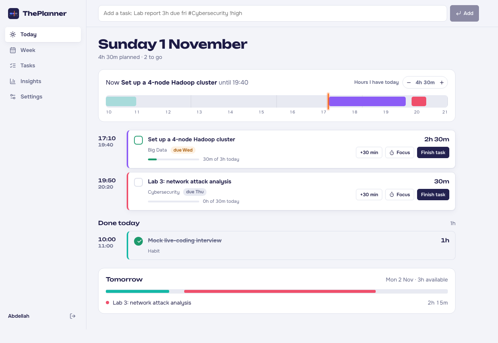
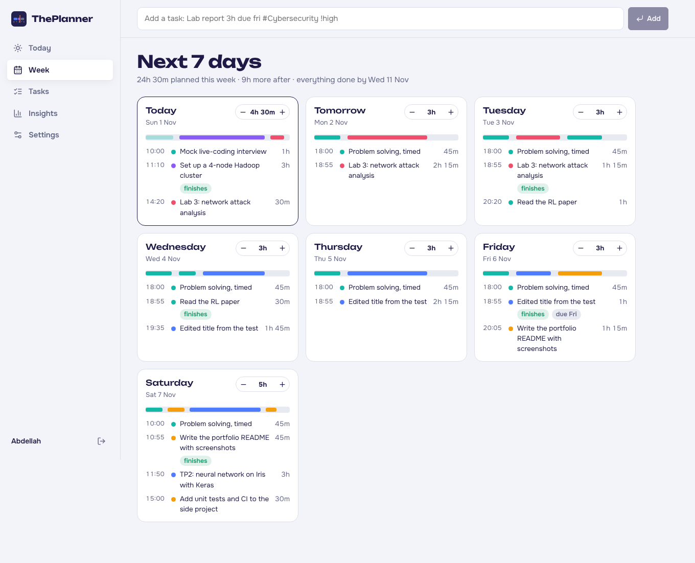
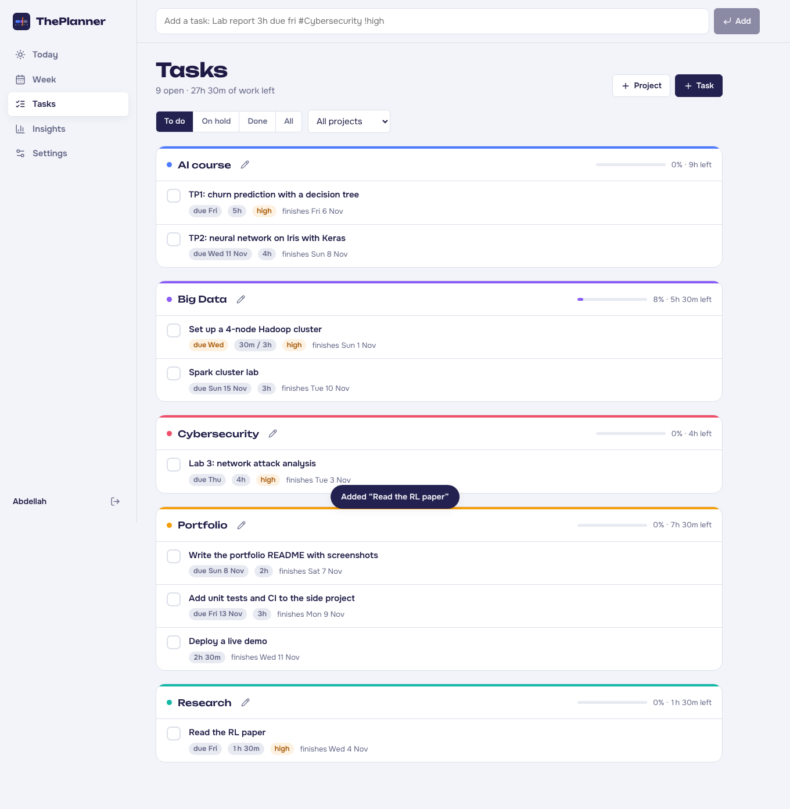
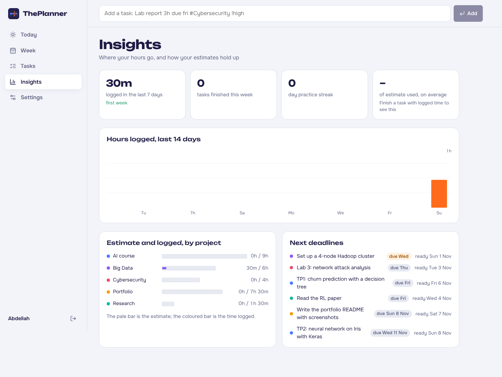
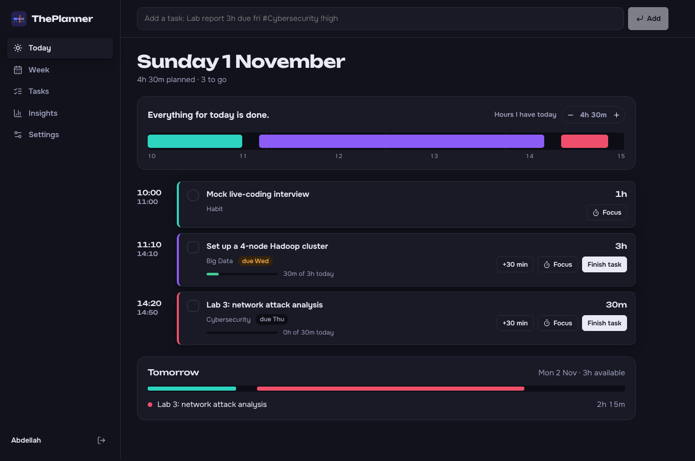
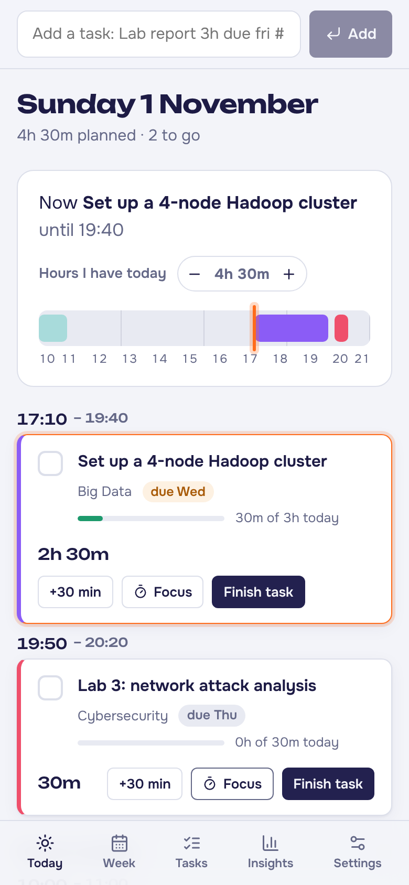
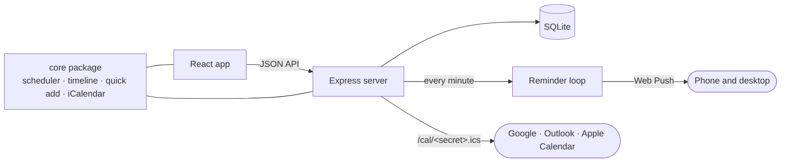

# ThePlanner

**ThePlanner turns your tasks, deadlines and free hours into a daily schedule.** Add what you need to get done with an estimate and a due date, tell it how many hours you have each day, and it lays out every day for you, earliest deadline first. It warns you early when a deadline won't fit, and reminds you before each block.

[](https://github.com/abdellahBSK/ThePlanner/actions/workflows/ci.yml)



## Features

- **Automatic scheduling.** Each day's hours are filled earliest deadline first, then by priority, with a cap on how long one task can take in a day. Change a task, finish one early or fall behind, and the plan reflows instantly.
- **Variable hours.** Set your usual hours and start time for each weekday, then change any single day with − / +.
- **Deadline risk.** Tasks that won't be done in time are flagged with the date they would actually finish, so you can add hours, cut scope or move the deadline while there's still time.
- **Today, live.** The day tape shows your day to scale with a "now" marker. Unfinished work is replanned from the current time, and finished work moves to "Done today".
- **Quick add in one line.** `Lab report 3h due fri #Cybersecurity !high` creates a 3-hour, high-priority task due Friday in the Cybersecurity project. It understands `today`, `tomorrow`, weekdays, `next mon`, `in 3 days`, `7/11`, `nov 20` and `90m`. Press <kbd>/</kbd> anywhere to type one.
- **Habits.** Daily practice such as interview problems gets its time reserved before tasks are planned, with a streak in Insights.
- **Focus timer.** Start a countdown for any block; stopping it logs the time you worked.
- **Reminders.** Browser push notifications with your plan each morning and a heads-up before each block, on phone and desktop. Install it as an app from the browser.
- **Calendar feed.** Subscribe from Google Calendar, Outlook or Apple Calendar to see the next two weeks of blocks there.
- **Insights.** Hours logged per day, estimate against actual by project, upcoming deadlines and how accurate your estimates are.
- **Accounts.** Anyone can sign up; each person's data is private. Light and dark themes, works at phone width.

| Week | Tasks |
| --- | --- |
|  |  |
| **Insights** | **Dark theme** |
|  |  |

<p align="center"></p>

## Run it

### With Docker

```bash
git clone https://github.com/abdellahBSK/ThePlanner.git
cd ThePlanner
docker compose up -d
```

Open **http://localhost:3000** and create an account. On an empty account, **Load an example semester** fills in sample tasks so you can see it working.

### With Node.js

Needs Node.js 22.5 or newer. There's no database server to install: data lives in a SQLite file using Node's built-in driver.

```bash
npm install
npm run build
npm start            # http://localhost:3000
```

For development, `npm run dev` starts the API on port 3000 and the web app with hot reload on **http://localhost:5173**.

## Configuration

Everything works without configuration. Secrets that aren't set are generated on first start and kept in the data folder.

| Variable | Purpose | Default |
| --- | --- | --- |
| `PORT` | Port to listen on | `3000` |
| `PUBLIC_URL` | Address people use to reach the app; used in calendar feed links. Use `https://` in production so cookies are secure | `http://localhost:PORT` |
| `DATA_DIR` | Folder for the database and generated secrets | `./data` (Docker: `/data`) |
| `JWT_SECRET` | Signs session cookies | generated |
| `VAPID_PUBLIC_KEY`, `VAPID_PRIVATE_KEY`, `VAPID_SUBJECT` | Keys for push notifications | generated |

Browsers only allow push notifications on `https://` sites and on `localhost`. To use reminders on your phone, deploy behind HTTPS (any reverse proxy, or a host like Render, Railway or Fly.io) and set `PUBLIC_URL`.

## How it works



The scheduling logic lives in one shared TypeScript package, `@theplanner/core`, used by both the browser and the server. The web app computes the plan instantly as you edit, and the server builds the same plan for reminders and the calendar feed.

### Scheduling rules

1. Each day's free time is its hours minus the habits planned that day.
2. Open tasks are sorted by deadline, then priority, then size.
3. Each day is filled in that order, in quarter-hour steps, giving one task at most the daily cap.
4. Work left on a task is counted from the start of today, so logging time during the day doesn't reshuffle today's plan.
5. A task is at risk when its last block lands after its deadline, or it doesn't fit in the next six weeks.
6. On the clock, habits come first, then tasks, from the day's start time (or from now, for what's left today), with a short break between blocks.

### Project structure

```
packages/core     Scheduler, timeline, quick-add parser, iCalendar writer (pure TypeScript, unit tested)
apps/server       Express API, SQLite storage, accounts, reminders, calendar feed
apps/web          React app (Vite): Today, Week, Tasks, Insights, Settings
```

### Security

- Passwords are hashed with bcrypt; sessions are signed, `HttpOnly`, `SameSite=Lax` cookies.
- The API only accepts JSON bodies, which, together with `SameSite` cookies, blocks cross-site request forgery.
- Sign-up and sign-in are rate limited; every query is scoped to the signed-in user, and tests check that one user can't read or change another's data.
- The calendar feed uses a long random link that can be replaced from Settings.

## Tests

```bash
npm test
```

Unit tests cover the scheduler, timeline, date and quick-add parsing, and the iCalendar output. API tests cover accounts, validation, privacy between users, the calendar feed and the reminder timing. CI also type-checks everything, builds the Docker image, and signs up and loads a plan through the running container.

## Roadmap

- [ ] Weekly review email
- [ ] Two-way Google Calendar sync, so the plan avoids your existing events
- [ ] Recurring tasks
- [ ] Shared projects for group work

## License

MIT
